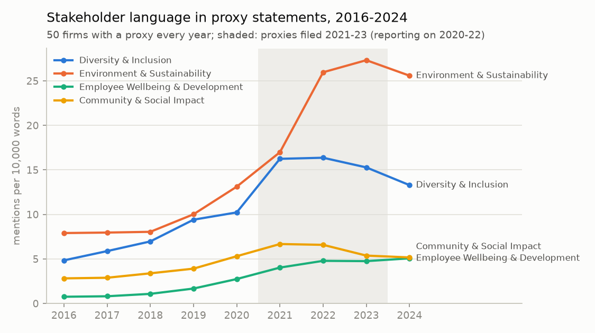

# Part 2 — Lived values: what firms disclose in their proxy statements

## Summary (non-technical)

**Question.** Beyond what firms say on their website, what do their formal disclosures give attention to, and how did that change from 2016 to 2024?

**Document.** The annual **proxy statement**, which every US-listed company must file with the SEC before its shareholder meeting. It covers the board, executive pay and, more and more, diversity, workforce and sustainability oversight. We collected **all 450** (50 firms × 9 years) from SEC EDGAR.

**Method.** We counted how often each of the same 12 value themes used in Part 1 appears, per 10,000 words, using a published keyword list ([`shared/value_codebook.py`](../shared/value_codebook.py)).

**Findings.**
1. **Stakeholder language surged after 2020.** Among all 50 firms, mentions of diversity & inclusion tripled, from 4.8 to 16.4 per 10,000 words between 2016 and 2022. Environment & sustainability rose from 7.9 to 27.3, and employee wellbeing & development from 0.8 to 5.1 (figure below).
2. **DEI language then fell, environment did not.** From 2022 to 2024, DEI mentions fell by about a fifth (16.4 → 13.3), and 68% of firms reduced them. Environment stayed near its peak (25.6).
3. **Sectors differ sharply.** Energy firms write about the environment 3–4 times as much as healthcare or technology firms (29.5 vs 8.3 and 9.6). Financial firms talk most about customers and clients (15.1). Healthcare talks most about innovation (6.3).
4. **Tone became more committed and less hedged.** Commitment words (commit, pledge, goal, target) rose from 26 to 35 per 10,000 words, while hedging words (may, could, strive) fell from 31 to 27.

**What this means.** Disclosures move with regulation and investor pressure. The 2021 jump follows the SEC's 2020 human-capital disclosure rule and investor campaigns on board diversity and climate. The 2024 DEI decline follows the 2023 Supreme Court ruling on affirmative action. These shifts are market-wide, so Part 3 compares each firm with its peers in the same year rather than with its own past.

---

## Technical notes

### Pipeline
| Script | Does | Output |
|---|---|---|
| `01_collect_proxies.py` | Finds every DEF 14A / DEFC14A on EDGAR, picks the annual-meeting proxy per year, stores its text | `part2_proxy_index.csv`, texts in `data/raw/proxies/` (not committed) |
| `02_measure.py` | Category rates, category shares, tone rates per proxy | `part2_firm_year.csv` |
| `03_analyze.py` | Trends (balanced panel), sector means, event windows, figure | `part2_results.txt`, `fig_stakeholder_trends.png` |

Run: `set SEC_USER_AGENT=Your Name you@example.com` (the SEC requires a contact in automated requests), then the three scripts in order. The download takes ~40 minutes; the rest takes seconds.

### Decisions (DECISIONS.md D-012)
- **Proxy statements rather than ESG/DEI reports.** They are mandatory, annual, in one free place and in comparable form, so coverage is complete (450/450) and the method scales to 500 firms unchanged. ESG/DEI reports are voluntary, start in different years and need manual collection.
- **One proxy per year.** A proxy filed in December counts for the next year (Apple). Contested-election proxies (DEFC14A) are included (ExxonMobil 2021, McDonald's 2022). Special-meeting proxies are skipped by requiring an "annual (general/shareholders') meeting" in the opening text. Broadcom's 2016–17 proxies come from its predecessor registrant.
- **A dictionary, not an LLM.** Proxies are about 50,000 words long (median). A transparent keyword count is reproducible, takes seconds, and uses the same categories as Part 1. Patterns avoid proxy phrases that would cause false hits ("equity awards", "with respect to").
- **Events (by filing year; a proxy filed in year t reports on t−1):** 2016–20 baseline; 2021–23 after 2020 (racial-justice protests, COVID-19, the SEC human-capital rule of Nov 2020); 2024 after the June 2023 SFFA ruling.

### Data dictionary — `part2_firm_year.csv` (450 rows)
| Column | Meaning |
|---|---|
| `ticker`, `company_name`, `sector`, `year` | Firm and proxy year (sector as in the assignment) |
| `proxy_status` | `ok` (all 450) |
| `filing_date`, `proxy_url` | Filing date and the document on EDGAR |
| `n_words` | Length of the proxy text |
| `rate_<category>` | Mentions of the category per 10,000 words (12 columns) |
| `share_<category>` | Category's share of all value mentions in that proxy (sums to 1); used in Part 3 |
| `tone_commitment`, `tone_hedging`, `tone_numbers` | Commitment words, hedging words and percentages per 10,000 words |

### Assumptions and limitations
- **Mentions are not actions.** A proxy that talks more about diversity has not necessarily done more. This measures disclosed *attention*.
- **Proxies are partly boilerplate.** Pay-for-performance language inflates "performance" for every firm. Comparing firms within a year (Part 3) removes what all proxies share.
- **A dictionary cannot read context.** "Customers" in a risk paragraph counts the same as in a values statement. Agility is barely measurable this way (0.1 per 10,000 words).
- Proxy length grew over time, so rates (per 10,000 words) rather than counts are compared.

### With more time
- Code only the relevant sections (human capital, ESG oversight, board diversity) instead of the whole proxy.
- Add the 10-K "Human Capital" section (required since 2020) as a second disclosure channel.
- Use an LLM to separate commitments with numbers and dates from general statements.
