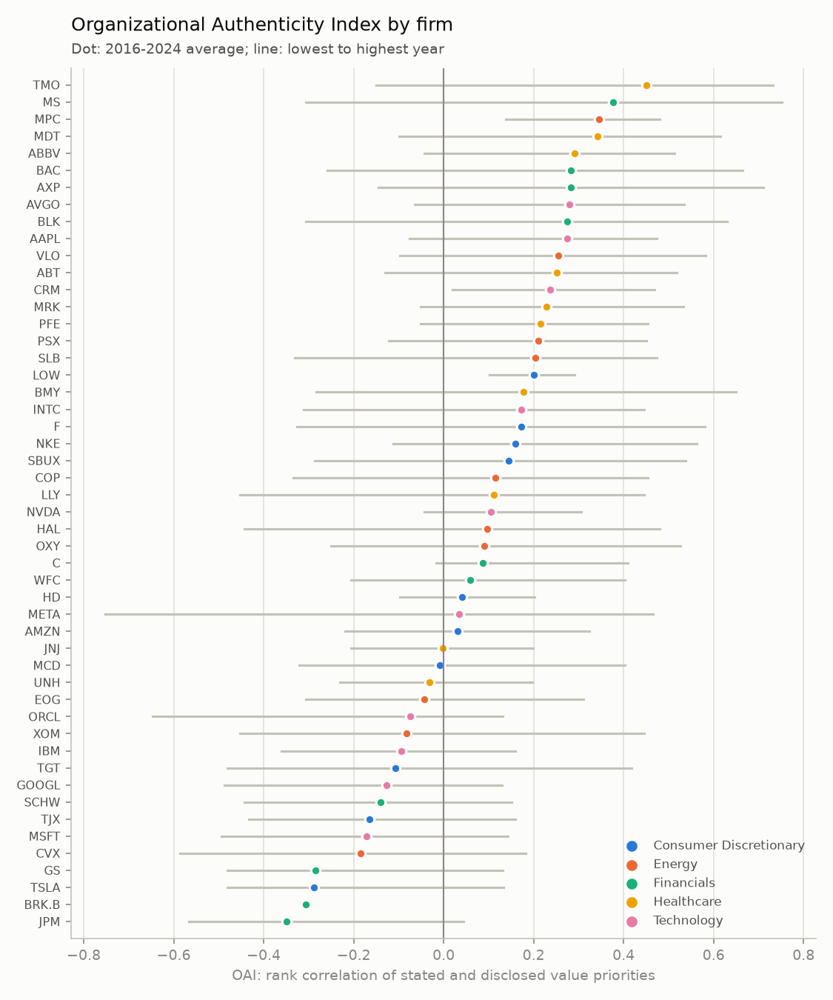

# Part 3 — The Organizational Authenticity Index (OAI)

## Summary (non-technical)

**Idea.** A firm is "authentic" here if the values it puts first on its website are also the ones its formal disclosures give unusual attention to. The index asks: *do the website's priorities and the proxy statement's priorities line up?*

**How it is built.** For each firm and year:
1. **Said** (Part 1): each of the 12 value themes scores 2 if it is a headline value on the About/values page, 1 if mentioned, 0 if absent.
2. **Disclosed** (Part 2): each theme's share of the value language in that year's proxy, compared with all other firms that year. Positive means more attention than the average firm; negative means less.
3. **OAI** = how well the two rankings agree (rank correlation), from −1 (opposite priorities) through 0 (unrelated) to +1 (same priorities).

Comparing each firm with its peers in the same year matters. Every proxy is full of pay-for-performance language, and every proxy added ESG language after 2020. Without the comparison, all firms would look "aligned" on the same things.

**Results.** 416 company-years, all 50 firms.
- **Alignment is weak on average but varies a lot.** Mean 0.09, standard deviation 0.30, middle half between −0.14 and 0.31. 41% of the variation is between firms and 59% is change within firms over time, so the index moves both across companies and over time, as the brief requires.
- **Most claimed values get only average or below-average attention in disclosures.** A firm states on average 4.1 of the 12 values on its website. For 2.3 of them, its proxy gives less attention than the average firm (`n_stated_not_disclosed`).
- **Healthcare is most aligned** (mean 0.21). Its websites stress patients, innovation and community, and its proxies do too. Consumer discretionary is least aligned (0.01).
- **Highest firms:** Thermo Fisher, Morgan Stanley, Marathon Petroleum, Medtronic, AbbVie. **Lowest:** JPMorgan, Berkshire Hathaway, Tesla, Goldman Sachs, Chevron (figure).

**Is it measuring something real? (validity check).** If the index captures *firm-specific* alignment, a firm's website should match its **own** proxy better than other firms' proxies. It does. Own-proxy OAI averages 0.09, against 0.00 for the same website compared with every other firm's proxy that year (difference t = 6.0; own higher in 59% of company-years). A measure that only reflected industry language or the general trend would show no difference.

**Face validity, with a warning.** Some extremes are partly artefacts. Berkshire Hathaway's "website" is a bare homepage, so its stated profile is nearly empty. Others (JPMorgan, Tesla, Goldman Sachs) are firms whose websites and proxies stress different things; the per-year rows in `part3_index.csv` link back to both documents for inspection. A low OAI is a reason to look closer, not a verdict.

---

## Technical notes

**Script:** `01_build_index.py` → `data/outputs/part3_index.csv`, `part3_results.txt`, `fig_oai_by_firm.png`. Runs in about a minute.

**Columns of `part3_index.csv`:** `ticker`, `company_name`, `sector`, `year`, `oai` (Spearman ρ between stated and disclosed profiles over 12 categories; empty when the website coding has no variation, 9 cases), `oai_placebo` (mean ρ of the same stated profile with all other firms' proxies that year), `n_stated` (categories on the website), `n_stated_not_disclosed` (stated categories with below-average proxy attention).

**Why this operationalisation (DECISIONS.md D-013).**
- *Rank correlation:* the two sources are on different scales (a 0–2 coding vs. word shares); only the order of priorities is comparable.
- *Peer-relative disclosure (z-score within year):* removes genre and time effects shared by all proxies.
- *A whole profile:* authenticity concerns a firm's priorities as a set. The per-category count is kept for interpretation.
- *Rejected:* raw cosine similarity (dominated by categories every proxy shares); an LLM rating of "authenticity" (not reproducible, and the definition would be hidden in a prompt).

**Limitations / threats to validity.**
1. **Disclosure is not behaviour.** The proxy shows what a firm *reports*, not what it *does*. OAI measures the consistency of two kinds of talk, which is a proxy for authenticity, not a direct measure. Behavioural data (workforce diversity numbers, emissions, fines, lawsuits) would be the stronger test.
2. **Different genres.** A website is marketing; a proxy is a legal and governance document. Some categories (customer, agility) are natural on a website and rare in a proxy for every firm. Peer-standardisation helps but cannot remove this.
3. **Measurement noise on both sides.** Website themes come from a small LLM (Part 1, κ 0.49–0.96 by category); disclosure themes come from a keyword count. Noise pulls correlations toward zero, so the true alignment is probably stronger than measured.
4. **Only 12 points per correlation.** A single firm-year OAI is noisy (±0.3 is common from year to year). Averages over years or groups are more reliable than any one value.
5. **Timing.** A proxy filed in year *t* reports on *t−1*, and the website is observed in mid-*t*. A one-year lag is a natural robustness check.

**With more time:** lagged and multi-year versions of the index; add behavioural outcomes (EEO-1 workforce data, emissions, controversies) as a test of whether higher OAI predicts doing what is said; weight categories by how distinctive they are for the sector.
