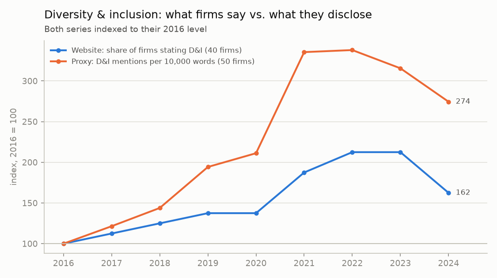

# Part 4 — When firms took DEI off their website, did their disclosures follow?

## Summary (non-technical)

**Why this question.** Part 1 showed diversity & inclusion (DEI) language on corporate websites peaking in 2022–23 and falling in 2024. For authenticity, it matters *what kind* of retreat this is:
- **Real change:** the firm stopped the programmes, so the website and the formal disclosures both fall.
- **Changing the message:** the firm only removed the words from its most public page, while its disclosures keep reporting the same work. Or the reverse.

Comparing the two channels for the same firms tells these apart.

**What we did.** For the 43 firms observed on both channels in 2022 and 2024, we grouped them by their **website**: dropped DEI, kept it, or never had it. We then compared the change in their **proxy statement's** DEI language over the same years. We ran the same comparison for environment & sustainability.

**Findings (exploratory; groups are small).**
1. **Proxy DEI language fell almost everywhere, whatever the website did.** Most firms that **dropped** DEI from their website also cut it in their proxy (6 of 7; median −15%). But so did firms that **kept** it (7 of 11; −11%) and firms that **never** had it (16 of 23; −29%). The disclosure retreat is market-wide, not tied to website decisions.
2. **Individual firms diverge in both directions.** Starbucks cut both channels (proxy 21.0 → 3.4 per 10,000 words). Charles Schwab removed DEI from its website while its proxy DEI language rose tenfold (3.1 → 32.3). The channels can move independently.
3. **Environment shows the opposite decoupling.** Of the 10 firms that dropped environment language from their website, 9 *increased* it in their proxy (median +43%). So did most firms that never had it on their website (11 of 13). Climate disclosure kept rising under investor and regulatory pressure regardless of the marketing message.
4. **Over the whole period the two channels move together, but disclosures move more** (figure). Both peak in 2022 and fall by 2024. The proxy index rose to 3.4× its 2016 level, the website index to 2.1×.

**What it means for measuring authenticity.** Website statements and formal disclosures respond to different pressures. Websites follow branding and the political climate; disclosures follow regulators and investors. So "the firm stopped *saying* X" and "the firm stopped *reporting* X" are separate events. An authenticity measure should track both channels rather than infer one from the other. The Schwab and environment cases are exactly the say–do gaps such a measure is meant to catch.

---

## Technical notes

**Script:** `01_dei_retreat.py` → `data/outputs/part4_results.txt`, `part4_firm_changes.csv`, `fig_stated_vs_disclosed.png`.

**Design.** Website status from Part 1 (`theme_categories` contains the category) in 2022 and 2024. Proxy rate from Part 2 (`rate_<category>`, mentions per 10,000 words) in the same proxy years. Groups: dropped (2022 yes → 2024 no), kept, never, added. Reported per group: mean rates before and after, mean change, median % change, share of firms whose proxy rate fell. Trend figure: website share of firms stating DEI (40 firms observed every year) and mean proxy DEI rate (50 firms), each indexed to 2016 = 100, on one axis.

**Limitations.**
- **Small groups** (7 "dropped" firms for DEI) and no controls. Descriptive and exploratory, not causal.
- **Website coding noise.** A single-year flip in the LLM coding can move a firm between groups. Part 1's carry-forward rule removes flips while the text is unchanged, but not all of them.
- **A proxy's DEI rate mixes board-diversity reporting** (driven by Nasdaq and investor policies) with workforce DEI. A section-level split would sharpen the comparison.

**With more time:** extend to all years with an event-study around each firm's website change; separate board-diversity from workforce-DEI passages; add the 10-K human-capital section as a third channel.
